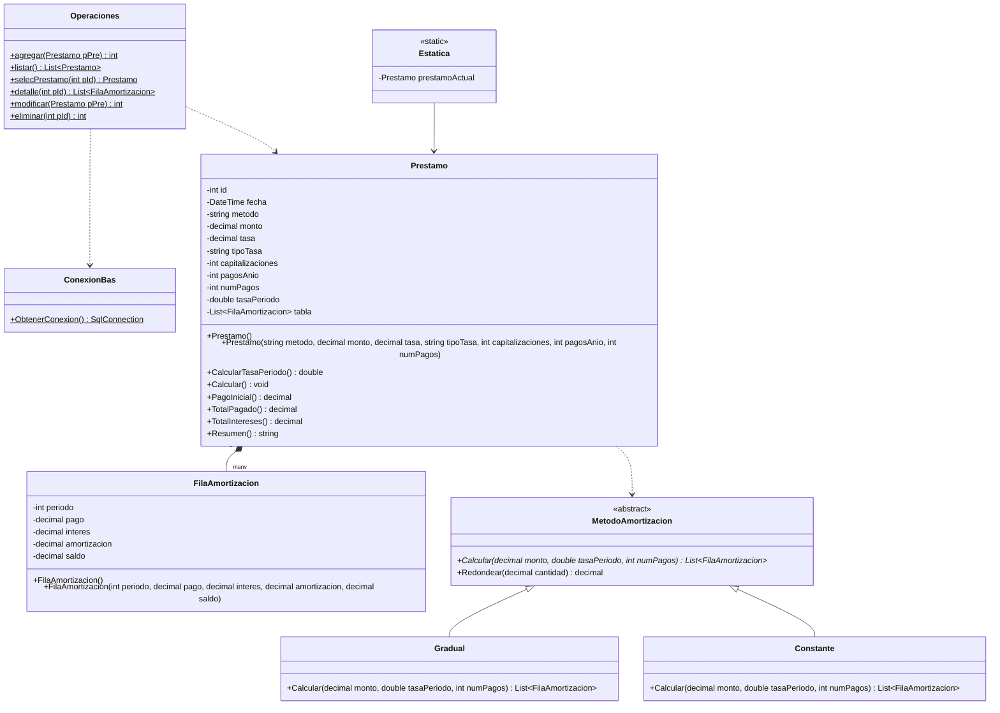

# Calculadora de Amortización

Proyecto final de Programación 3. Aplicación en C# (Windows Forms) para Matemáticas Financieras: calcula la tabla de amortización de un préstamo con el **método gradual** (pagos iguales) o el **método constante** (amortización igual) y guarda los cálculos en SQL Server.

## Requisitos

- Visual Studio 2022 con el workload **Desarrollo de escritorio de .NET** (.NET 8)
- SQL Server Express (`localhost\SQLEXPRESS`) y SQL Server Management Studio

## Cómo ejecutarlo

1. Abrir SQL Server Management Studio, conectarse a `localhost\SQLEXPRESS` y abrir **Nueva consulta**.
2. Ejecutar el archivo `amortizacion_db.sql` en dos partes:
   - Parte 1: solo `CREATE DATABASE Amortizacion;`
   - Parte 2: desde `USE Amortizacion;` hasta el final
3. Abrir `CalculadoraAmortizacion.csproj` en Visual Studio y ejecutar (F5). El paquete `System.Data.SqlClient` se descarga solo.

## Clases

| Clase | Qué hace |
| --- | --- |
| `Prestamo` | Datos del préstamo; calcula la tasa por periodo, la tabla y los totales |
| `FilaAmortizacion` | Un renglón de la tabla (periodo, pago, interés, amortización, saldo) |
| `MetodoAmortizacion` | Clase abstracta con el método `Calcular` |
| `Gradual` | Hereda de `MetodoAmortizacion`: pagos iguales |
| `Constante` | Hereda de `MetodoAmortizacion`: amortización igual |
| `ConexionBas` | Abre la conexión a SQL Server |
| `Operaciones` | Agregar, listar, buscar, modificar y eliminar en la base de datos |
| `Estatica` | Pasa el préstamo elegido del Historial a la Calculadora |
| `FormPlantilla` | Formulario base (encabezado y Salir) |
| `FormCalculadora` | Captura, cálculo, guardar y modificar |
| `FormHistorial` | Lista de cálculos guardados, ver detalle y eliminar |

## Diagrama de clases

